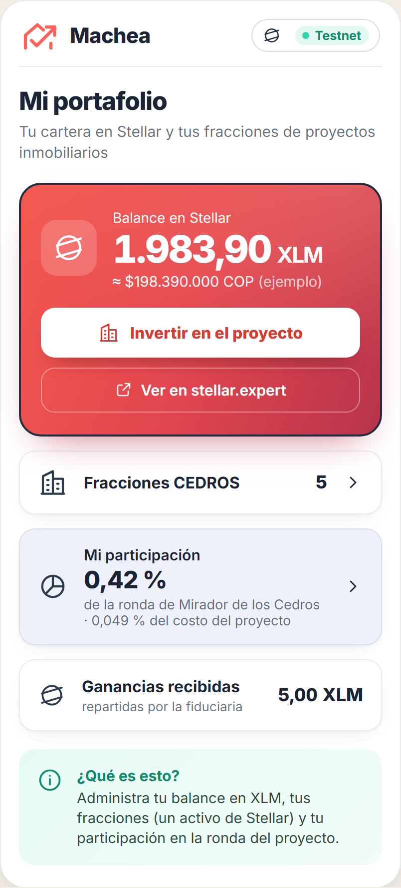
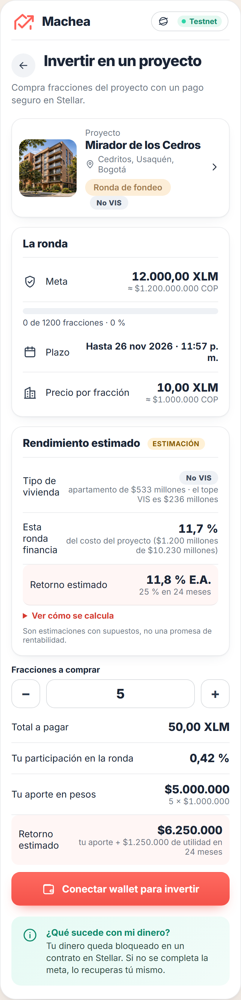
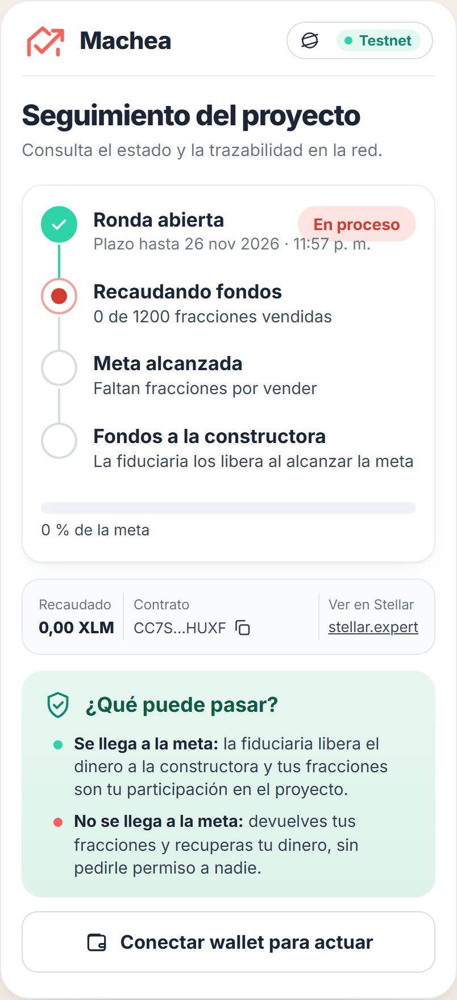

# Pantallas de la dApp · Equipo Machea

> Se llena en el taller en casa de la semana 3 (GUIA_S3, paso 1.6; bocetos en Figma o en papel, foto en esta carpeta). Tres pantallas, no más: lo que no quepa aquí no entra al Demo Day.

## El problema en una frase

Una persona con montos pequeños no puede invertir en un proyecto inmobiliario porque tiene que confiar su dinero a un tercero que lo administra sin que ella vea qué pasa; con la app, cualquiera compra fracciones del proyecto (un activo de Stellar), el dinero queda bloqueado en un contrato a la vista de todos, y se libera a la constructora si se completa la meta o si la fiduciaria cierra la ronda antes del plazo; si vence el plazo sin ninguna de las dos, cada inversionista recupera lo suyo.

## ¿Por qué Stellar?

- **Las fracciones son un activo de Stellar.** El contrato las emite al invertir y las destruye al reembolsar. Se ven en Varial y en stellar.expert, y se pueden pasar a otra persona con un pago normal.
- **Dinero bloqueado con una regla pública:** se libera si se completa la meta o si la fiduciaria cierra la ronda antes del plazo; si vence el plazo sin ninguna de las dos, se devuelve. El reembolso lo cumple el código; el cierre anticipado sí depende de la fiduciaria (ver la hoja de ruta del [README](../README.md)).
- **Trazabilidad verificable:** cualquiera ve en stellar.expert cuánto se ha recaudado y quién tiene fracciones, sin pedirle el dato a un intermediario.
- **Reembolso sin permiso:** si vence el plazo sin que la ronda llegue a la meta ni se cierre, cada tenedor recupera su dinero por su cuenta.
- **Comisiones de centavos** y confirmación en segundos.

## Las tres pantallas

| # | Pantalla | Qué ve el usuario | Qué toca | Operación de Stellar que dispara | Qué muestra después | ¿Existe hoy? |
|---|---|---|---|---|---|---|
| 1 | Mi portafolio | Balance en XLM, sus fracciones del proyecto y su participación (fracciones ÷ total) | «Conectar wallet», «Ver todos los proyectos» (abre el catálogo) y «Ver en stellar.expert» | Ninguna que firme: Varial solo entrega la dirección y la app lee la cuenta en Horizon | Balances y % de participación | Sí |
| 2 | Invertir en un proyecto | El proyecto, la meta, lo recaudado con su barra de avance, el plazo, el precio por fracción y cuántas fracciones comprar | «1. Aceptar el activo» y luego «Invertir con Varial» | `changeTrust` (aceptar el activo) y una llamada `invertir` al contrato de fondeo | Mensaje con el hash y las fracciones en su wallet | Sí |
| 3 | Seguimiento del proyecto | Los pasos de la ronda (ronda abierta, recaudando, meta alcanzada, fondos a la constructora), el recaudado y el contrato | «Recuperar mi dinero» si la ronda falló; la fiduciaria ve «Liberar fondos» | Lectura `resumen` del contrato, sin firma. `reembolsar` (el tenedor) y `liberar` (la fiduciaria) sí firman | Estado actual y qué puede pasar | Sí |

Además de las tres pantallas, la app tiene la pestaña **Proyectos** (el catálogo: elige la ronda de uno de los seis proyectos) y el **portal de la fiduciaria** (pestaña **Fiduciaria**, que solo aparece al conectar la wallet de la fiduciaria; también se abre con `#fiduciaria`), donde la fiduciaria ve las seis rondas y libera fondos o reparte ganancias con su wallet. En «Seguimiento» también hay un panel de la fiduciaria para la ronda activa; ambos solo aparecen o actúan con la wallet de la fiduciaria.

Lectura vs. escritura: las pantallas 1 y 3 leen; la pantalla 2 escribe, y Varial muestra y firma cada operación.

Capturas de la app en funcionamiento (los valores del portafolio y de la compra son de ejemplo; el seguimiento lee la ronda real en testnet):

| 1 · Mi portafolio | 2 · Invertir en un proyecto | 3 · Seguimiento del proyecto |
|---|---|---|
|  |  |  |

## Cuentas que necesita la demo

| Rol | Cuenta | Quién la controla |
|---|---|---|
| Activo de las fracciones (ronda por defecto) | `CEDROS` · emisora `GAK6FDVYLICN6GTW7TVEZJ65PWNM3OV474PMWQKBYS6VYPL2PLTV2SYB` | El equipo (stellar-cli, alias `emisor-rondas`) |
| Contrato de fondeo (ronda por defecto) | `CAJISXLJQL67VLMTJSLD2BVE2GFVIEYYAZB5AW3JFR4K3PSSHI7XKLE4` | El equipo, desplegado en testnet |
| Otras cinco rondas del catálogo | Ver la tabla del [README](../README.md) | El equipo, desplegadas en testnet |
| Fiduciaria (libera los fondos) | `GAATGMTDWWWTRSFYMDKCGGV2ALLFFOSWTSJPJGIGDGSU4J2POOGLNFWX` | La wallet de Varial de Santiago (en la vida real, una fiduciaria) |
| Constructora (recibe si se completa la meta o se cierra la ronda antes) | `GA2QOK3VLE2EHD4JOSO2D423YOTZWQMMPQGMI5JCEAHCEJM7JK2OBXDW` | El equipo, cuenta de prueba |
| Inversionista 1 | Varial de Santiago · `GAATGMTDWWWTRSFYMDKCGGV2ALLFFOSWTSJPJGIGDGSU4J2POOGLNFWX` | Santiago |
| Inversionista 2 | Varial de Juan Diego · `GAO67COWV7DBLSGNRLKW736HA6U4LAE7T5ACL2PJJHTEMPEFVXZBIT2K` | Juan Diego |

## Flujo de la demo (3 minutos, en orden)

1. El inversionista conecta Varial y ve su portafolio.
2. Entra a «Invertir», acepta el activo y compra fracciones: Varial firma y el activo aparece en su wallet; se muestra el hash.
3. En «Seguimiento» sube la barra de avance. Se completa la meta y la fiduciaria libera el dinero a la constructora. Después reparte ganancias y el inversionista las ve en «Mi portafolio».
4. Segunda ronda con plazo de 2 minutos que no llega a la meta: pasa el plazo y el inversionista pulsa «Recuperar mi dinero»; sus fracciones se destruyen y recupera su dinero.

## Después de la demo (mapa de ruta)

- **Reparto de ganancias dentro del contrato:** hoy la fiduciaria reparte el arriendo o la venta desde su panel en «Seguimiento» y la app lo muestra en el portafolio; que el propio contrato lo reparta queda para la siguiente etapa.
- **Camino a la casa:** usar las fracciones como cuota inicial de un apartamento.
- **Inversionistas verificados:** que la fiduciaria apruebe cada wallet con las opciones de autorización de los activos de Stellar.
